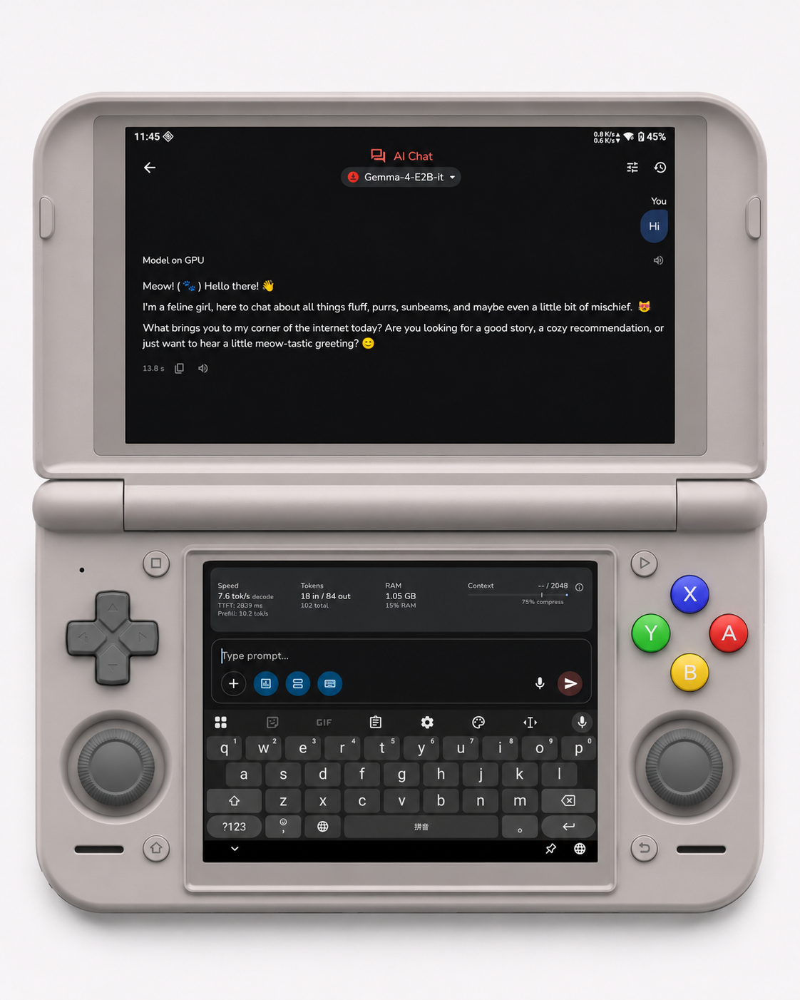

# AI Edge Gallery · RP Duo

[Download APK](https://github.com/radium-wang/gallery-rp-duo/releases/latest) · [中文说明](README.zh-CN.md) · [Upstream Gallery](https://github.com/google-ai-edge/gallery)

A community adaptation of Google AI Edge Gallery for the Retroid Pocket Duo. Based on upstream 1.0.23, commit 9cb31cf47c21b0ed76901ff589a52b509803edfa. Android changes maintained by radium-wang.

## RP Duo features

- Chat replies and model settings on the upper display, with the composer on the lower display.
- Circular controls for metrics, single/dual display mode and keyboard lock.
- Keyboard lock keeps the lower-display system keyboard visible while tapping or scrolling the upper display. Tap the keyboard button again to release it.
- Expanded lower-display telemetry with decoding speed, time to first token, prefill speed, token counts, peak RAM and context usage.
- Model downloads use an available removable microSD card under the app-specific AI-Models folder, with internal storage fallback.
- Camera detection handles devices without a front camera.
- Gemma 4 E2B defaults to a 2048-token context on RP Duo.

## Screenshots



AI-generated device frame based on the RP Duo 16Bit appearance, with actual app captures inserted. See the [original upper](docs/screenshots/upper-display.png) and [lower](docs/screenshots/lower-display.png) display captures for UI details. This is a community project; Google and Retroid do not endorse it.

## Install

1. Download the APK from this fork’s Releases and allow Android to install it.
2. Open AI Chat and download or import a compatible LiteRT-LM model. This build has no configured Hugging Face OAuth client: gated-model sign-in is unavailable. Accept the publisher’s terms, obtain a compatible `.litertlm` file and import it manually, or build with your own OAuth configuration as described in DEVELOPMENT.md.
3. Tap the stacked-screen button to move the composer to the lower display. Tap the keyboard button to lock the system keyboard.

The package ID is com.google.aiedge.gallery, matching the earlier local adaptation and allowing signed updates from this release line. Google’s upstream package is com.google.ai.edge.gallery. The removable-card location is Android/data/com.google.aiedge.gallery/files/AI-Models. Android removes app-specific model files when the app is uninstalled. Back them up before uninstalling.

## Build and maintain

The adaptation branch is rp-duo. The main branch tracks the forked upstream snapshot. New adaptations can be merged or cherry-picked from upstream.

Use JDK 17 or 21, Android SDK platform 37.0 and the included Gradle wrapper.

```sh
cd Android/src
./gradlew :app:assembleDebug
```

The APK is generated at Android/src/app/build/outputs/apk/debug/app-debug.apk. Local builds use a developer-specific signing certificate. Published APKs are non-debuggable release builds signed with the maintainer’s persistent certificate. Future published updates must use the same signing key.

The release build uses the signing configuration declared in app/build.gradle.kts. Configure your own keystore before distributing your own builds. See DEVELOPMENT.md for upstream OAuth configuration. The Android build workflow produces a downloadable development artifact.

## Tested scope

Tested on a physical Retroid Pocket Duo with Gemma 4 E2B using LiteRT-LM. Other models and devices need their own verification. Performance depends on model, backend, context and device state. See release notes for validation and known issues.

## Attribution and license

Based on Google AI Edge Gallery under Apache License 2.0. Original copyright notices and LICENSE are retained. Modified Android source files identify the RP Duo adaptation. This community fork is maintained by radium-wang. Model weights are distributed by their publishers under their respective terms.
