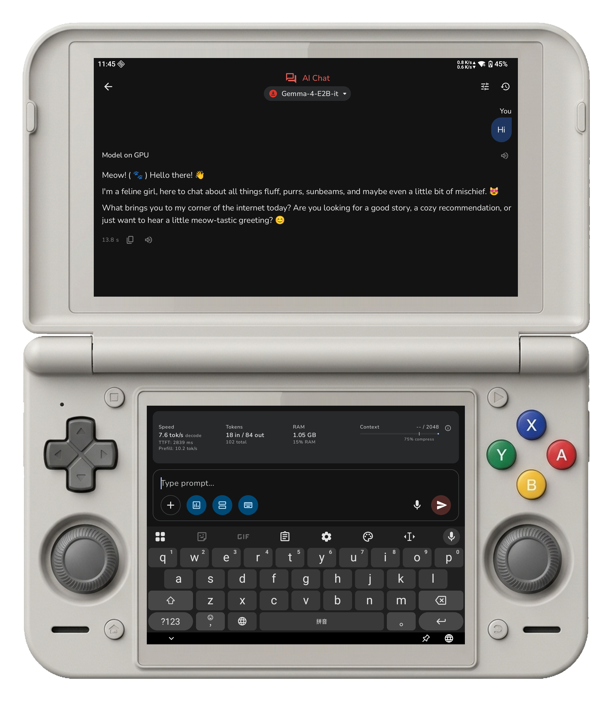

# AI Edge Gallery · RP Duo

[下载安装包](https://github.com/radium-wang/gallery-rp-duo/releases) · [English](README.md) · [原项目](https://github.com/google-ai-edge/gallery)

面向 Retroid Pocket Duo 的社区适配版，基于 Google AI Edge Gallery 1.0.23，由 radium-wang 维护。

  

[上屏真机截图](docs/screenshots/upper-display.png) · [下屏真机截图](docs/screenshots/lower-display.png)

使用用户提供的外框，按原比例填入真机截图。这是社区项目，与 Google、Retroid 无官方隶属关系。

## 适配功能

- 上屏显示对话和模型参数，下屏输入。
- 圆形按钮切换实时指标、单双屏和键盘锁定。
- 锁定后点按、滚动上屏时，下屏系统键盘保持显示。再次点击键盘按钮解除锁定。
- 下屏加高的数据面板显示生成速度、首字延迟、预填充速度、输入输出 Token、峰值内存和上下文使用量。
- 有可用 microSD 卡时，模型优先保存至卡内的应用专属 AI-Models 文件夹。
- 处理无前置摄像头的情况，RP Duo 的 Gemma 4 E2B 默认上下文为 2048。

## 安装使用

1. 从本仓库 Releases 下载 APK 并安装。
2. 进入 AI Chat 下载或导入兼容的 LiteRT-LM 模型。此构建未配置 Hugging Face OAuth，暂不支持受限模型的登录下载。请先接受模型发布者条款，自行取得兼容 `.litertlm` 文件并导入；自行编译时可按 DEVELOPMENT.md 配置 OAuth。
3. 点击叠放屏幕图标切换双屏，再点键盘图标开启固定。

应用包名为 com.google.aiedge.gallery，与之前的本地适配版相同。模型位于 SD 卡 Android/data/com.google.aiedge.gallery/files/AI-Models。Android 卸载应用时会清除应用专属目录，请先备份模型和应用数据。

截图、编译步骤和维护方式见英文 README。已在 RP Duo 真机上使用 Gemma 4 E2B 验证，其他模型及机型需要进一步测试。

## 开源与来源

沿用上游 Apache License 2.0，保留原作者版权声明和许可证。模型权重由相应发布者提供，按其模型条款使用。
